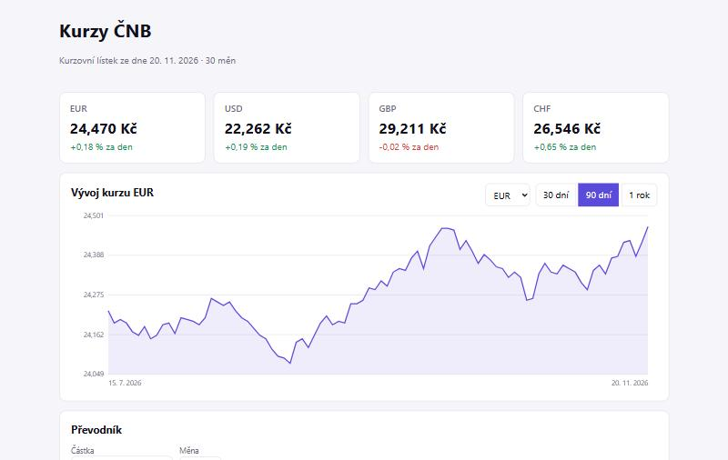

# Kurzy ČNB – datová pipeline

[](https://github.com/neubauerlukas207-cell/cnb-rates-pipeline/actions/workflows/pipeline.yml)

**Živě:** <https://neubauerlukas207-cell.github.io/cnb-rates-pipeline/>

Automatická pipeline, která **každý pracovní den** stáhne kurzy devizového trhu z České národní banky, zkontroluje kvalitu dat, uloží je do SQLite, spočítá statistiky a publikuje statický dashboard. Vše běží zdarma v GitHub Actions – bez serveru.



```
ČNB (TXT API) ──► parse ──► SQLite ──► kontrola kvality ──► statistiky ──► data.json + dashboard ──► GitHub Pages
                                         │ selže?
                                         └──► web se nepublikuje, zůstane poslední dobrá verze
```

## Co umí

- **Stažení** ročních historií a dnešního lístku, opakování při výpadku (exponenciální čekání), chyba 4xx se neopakuje.
- **Parsování** formátu ČNB: desetinná čárka, kurzy za 100/1000 jednotek, **změna hlavičky v půlce roku** (v roce 2022 ČNB přestala vyhlašovat rubl).
- **Idempotentní uložení** do SQLite (`INSERT … ON CONFLICT DO UPDATE`) – opakované spuštění nic nezdvojí, opravy kurzů přepíše. Kurz se ukládá přesně (`Decimal`), ne jako float.
- **Kontrola kvality** – zastaralá data, chybějící EUR/USD, málo měn = pipeline selže a nic nepublikuje. Podezřelé skoky a mezery = varování.
- **Statistiky** – změna za den / 30 dní / od začátku roku, roční rozpětí, volatilita (annualizovaná směrodatná odchylka denních log-výnosů).
- **Dashboard** bez knihoven: graf v SVG s tooltipem, výběr období, řaditelná tabulka všech měn, převodník.

## Testy

- **37 testů (pytest)** – parser na **skutečných souborech ČNB** (včetně roku 2022), chybné vstupy, databáze, statistiky, kontroly kvality, HTTP klient s podvrženou sítí (`httpx.MockTransport`: výpadky, opakování, 404) a celá pipeline od stažení po vygenerovaný web.
- **12 testů dashboardu v prohlížeči (Playwright)** na desktopu i mobilu – karty, graf, přepínání měny a období, řazení, převodník, žádné chyby v konzoli.
- CI spustí testy při každém pushi; plánovaný běh pak stáhne aktuální data a nasadí web.

## Technologie

Python 3.12 · httpx · SQLite · pytest · Playwright · ruff · vanilla JS + SVG · GitHub Actions (cron) · GitHub Pages

## Spuštění

```bash
python -m venv .venv && source .venv/bin/activate   # Windows: .venv\Scripts\activate
pip install -e ".[dev]"

cnb-rates run --out public          # stáhne data, zkontroluje, sestaví web
python -m http.server -d public     # → http://localhost:8000

pytest -m "not e2e"                 # rychlé testy
python -m playwright install chromium && pytest -m e2e   # testy v prohlížeči
```

## Struktura

```
src/cnb_rates/
  parse.py     # parser denního lístku a roční historie
  fetch.py     # HTTP klient s opakováním
  db.py        # SQLite schéma a idempotentní zápis
  quality.py   # kontroly kvality dat
  stats.py     # statistiky
  site.py      # data.json + šablona dashboardu
  cli.py       # příkazy update / check / build-site / run
  site/        # dashboard (HTML, CSS, JS)
tests/         # pytest + fixtures se skutečnými daty ČNB, e2e/ = Playwright
```
